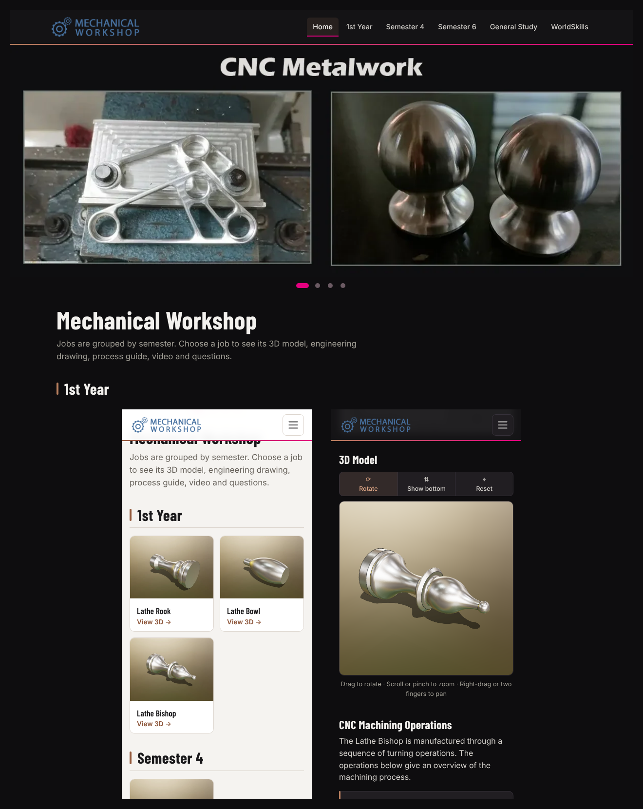

# Mechanical Workshop

Study site for the TKMCE mechanical workshop jobs, grouped by semester. Each job page has an
interactive 3D model, the engineering drawing, a process guide, a machining video and
(where available) sample / model questions.

**Live site:** https://machinisthands.github.io/ (front page) ·
job pages under https://machinisthands.github.io/mechanicalworkshop/

The front page (job cards by semester, slideshow, WorldSkills link) lives in the
[machinisthands.github.io](https://github.com/machinisthands/machinisthands.github.io) repository,
but it loads its pictures, styles and scripts from this one. So the look of the whole site is
changed here; only the front page's cards and text are changed there.
`index.html` in this repository just redirects to the front page.

## Theme

The site uses the same theme as the
[WorldSkills CNC Milling site](https://machinisthands.github.io/worldskills/)
("Steel, Copper & Magenta"): near-black background, copper for labels/links/buttons,
magenta only for small brand touches (header line, active menu item, active slide dot).
A light version is used automatically when the device is in light mode.

- **Colours:** set once in `:root` at the top of `css/style.css`. Change them there.
- **Fonts:** Inter (text) and Barlow Condensed (headings), self-hosted in `fonts/` (SIL OFL).
- **3D viewer:** the WorldSkills viewer: stainless-steel finish, thin CAD-style edge lines,
  workshop reflections and shadow, and the *Rotate / Show bottom / Reset* toolbar.
  To change the steel colour of every model, edit `STEEL` in `js/viewer.js`.



## Structure (HTML5 Boilerplate layout)

Pages, styles, scripts, images, models and documents each have one place:

```
.
├── index.html                 redirects to the front page (machinisthands.github.io/)
├── 1year/<job>/index.html     job pages (latheRook, latheBowl, latheBishop, edmScooter)
├── cncLathe/ cncMilling/ cncMillingSub/ toolAndCutterGrinding/   job pages (index.html only)
├── css/style.css              the only stylesheet (theme colours at the top)
├── fonts/                     Inter + Barlow Condensed (woff2, SIL Open Font License)
├── js/
│   ├── app.js                 menu, slideshow, ads config, lazy-loading of the 3D viewer
│   ├── viewer.js              3D viewer (same as the WorldSkills site; renders only when something moves)
│   ├── edges-worker.js        finds the sharp edges of a model for the CAD-style lines (Web Worker)
│   └── vendor/                three-bundle.min.js (three.js 0.170 + loaders, MIT, see three-LICENSE.txt),
│                              draco/ decoder (WebAssembly + JavaScript fallback),
│                              hdri/workshop.js (workshop reflections, Poly Haven CC0)
├── img/
│   ├── logo.png               "MECHANICAL WORKSHOP" logo, all blue (#4872A1)
│   ├── og-home.jpg            social preview of the front page (1200×630)
│   ├── banner/                slideshow: 04, 05 (CNC Metalwork), 07 (chess set), 08 (India shape) –
│   │                          NN.webp, NN-640.webp (phones), NN-light.webp, NN-light-640.webp (light mode)
│   └── jobs/<job>/            drawing.webp, drawing-900.webp, drawing-full.jpg, thumb.webp,
│                              thumb-light.webp, og.jpg (WhatsApp/Facebook preview, 1200×630)
│       jobs/worldskills/      card picture for the WorldSkills link on the front page
├── models/<job>.glb           Draco-compressed 3D models
├── docs/<job>/                process-guide.pdf, sample-questions.pdf, model-questions.pdf
├── doc/preview.png            screenshot used in this README
├── 404.html  robots.txt  sitemap.xml  site.webmanifest  .editorconfig
└── favicon.ico  icon.png  icon-512.png  icon.svg
```

Milling Sub uses the same sample / model question PDFs as Milling, so they are stored once
(`docs/cncMilling/`) and both pages link there.

Every page uses the HTML5 Boilerplate `<head>` order: charset, viewport, title, stylesheet,
description, Open Graph, icons, manifest, theme-color – followed by canonical URL and JSON-LD.
`js/app.js` is loaded at the end of `<body>`.

## How the pages are built

- **Semantic HTML:** `header`, `nav`, `main`, `article`, `section`, `footer`; one `h1` per page,
  `h2` for each section; menu and slideshow dots are real `<button>`s.
- **Flat DOM:** no framework wrappers – a job page has about 90 elements.
- **Structured data:** JSON-LD (`WebSite`, `Person`, `ItemList` on the home page;
  `LearningResource` + `BreadcrumbList` on each job page), canonical URL and Open Graph tags.
- **Speed:** no jQuery/Bootstrap; the 3D viewer (three.js ≈0.6 MB) loads only when the model
  scrolls into view, and the workshop reflections load after the model appears; images are
  lazy-loaded with fixed sizes; no full-screen loading spinner.

## Slideshow

The slideshow is the same on the front page and every job page. Each picture is 1224×455 and
comes in four files: `NN.webp`, `NN-640.webp` (phones), `NN-light.webp` and `NN-light-640.webp`
(light mode). Put the photo on the theme background (`#0E0D0F` dark, `#F5F3F0` light) so it
matches the page. To add a picture, add the four files to `img/banner/` and add one `<picture>`
line and one dot button to the `banner` section of every page (front page included).

## Card pictures

The card pictures (`img/jobs/<job>/thumb.webp`, 640×480) are screenshots of the job's 3D model in
the site's own viewer, so they match the theme. To make a new one: open the job page, wait for
the model, press *Rotate* to stop it and *Reset*, then screenshot the 3D area at 640×480.
`thumb-light.webp` is the same picture.

## Adding a new job

1. Copy an existing job folder (it only holds `index.html`) and rename it.
2. Add `models/<job>.glb`, `img/jobs/<job>/` (drawing, thumbnails, og.jpg) and `docs/<job>/` PDFs.
3. In its `index.html` update the title, description, JSON-LD block, heading, semester badge,
   menu links, model path and resource buttons.
4. Add a card on the front page (`index.html` in the machinisthands.github.io repository),
   the job to its JSON-LD list, and a line in `sitemap.xml` here.

Convert a model: `npx @gltf-transform/cli draco input.gltf models/<job>.glb`

## Ads (Google AdSense)

Every page loads the AdSense script and the `google-adsense-account` meta tag.
Ad spaces are already placed where they cannot be clicked by accident:

| Page | Ad space (`data-ad`) | Where |
|---|---|---|
| Job pages | `article` | after the Engineering Drawing (Lathe Bishop: between Operations and CNC Program) |
| Job pages | `end` | after Resources, before the footer |
| Front page | `home` | after all job cards, before the footer |

None are next to the menu, the 3D viewer, the slideshow dots or the resource buttons.
Each is labelled "Advertisement", has space reserved (no layout jump), hides itself when Google
has no ad to show, and disappears if an ad blocker stops AdSense.

### To switch the ads on

1. **Make the site eligible.** AdSense checks the domain root (`https://machinisthands.github.io/`).
   That is the machinisthands.github.io repository: it holds the front page and `ads.txt`.
   Add the site in AdSense and wait for approval.
2. **Create 3 ad units** in AdSense: *Ads → By ad unit → Display ads*, type *Responsive*.
3. **Paste the slot numbers** into `js/app.js` (top of the "Google AdSense" block):
   ```js
   slots: { article: "1234567890", end: "2345678901", home: "3456789012" }
   ```
   A slot left empty means that ad space is not shown at all.
4. **Turn Auto ads off** (or exclude the menu/3D areas) in AdSense, so Google does not add extra
   ads in places that clash with the page.

### Keeping ads safe for students

The code already sends `data-tag-for-age-treatment="2"` (Google's under-18 "teen" treatment) with
every ad request. The actual content filtering is done in AdSense:

1. **Brand safety → Content → Blocking controls → All sites → Sensitive categories** – block:
   Dating, Reference to Sex, Sexual & Reproductive Health, Gambling & Betting, Alcohol,
   Get Rich Quick, Black Magic / Astrology & Esoteric, Weight Loss, Cosmetic Procedures,
   Drugs & Supplements, Sensationalism (names can differ slightly by country).
   Restricted categories (e.g. Alcohol, Gambling) are blocked by default – keep them blocked.
2. **General categories → Apparel** – block *Swimwear* and *Underwear*.
3. **Ad review center** – check the ads shown on the site now and then, and block any single ad
   or advertiser that is not suitable.
4. **Auto ads** – keep off, so ads appear only in the reserved spaces.

Google filters on a best-effort basis and does not guarantee every unsuitable ad is caught,
so step 3 is worth doing regularly, especially after the site first goes live.
